## Creacion base, swift, core data.
- Borrar ViewController default.
- LaunchScreen
- Main
- Configurar Diseño
- Agregar otra pantalla con + ViewController
- Crearle ViewController a cada vista (CocoaTouchClass, UIViewController)
- Enlazar las vistas a sus CONTROLADORES 
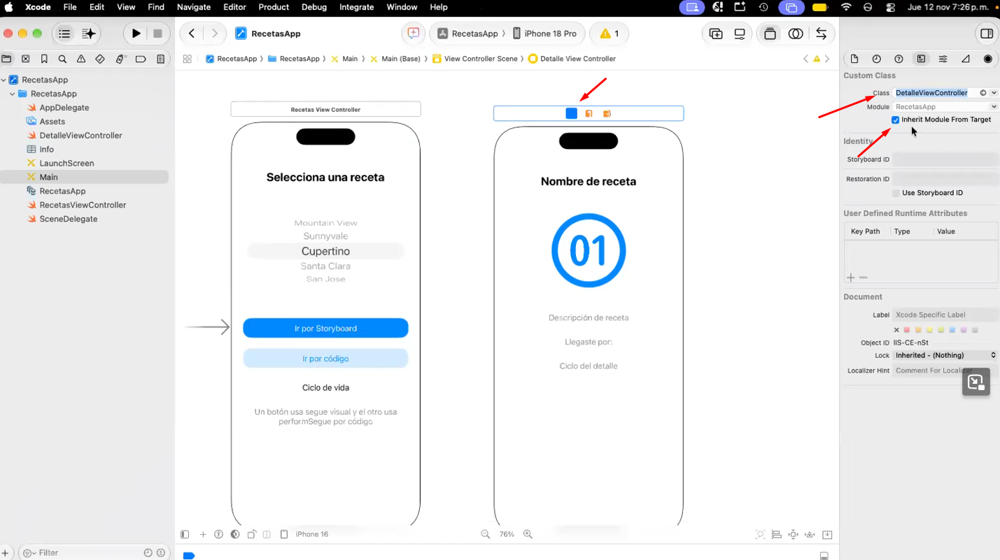
- Crear navigation Controller en (selecciono primer cuadro de arriba, editor, embed in, navigation controller)
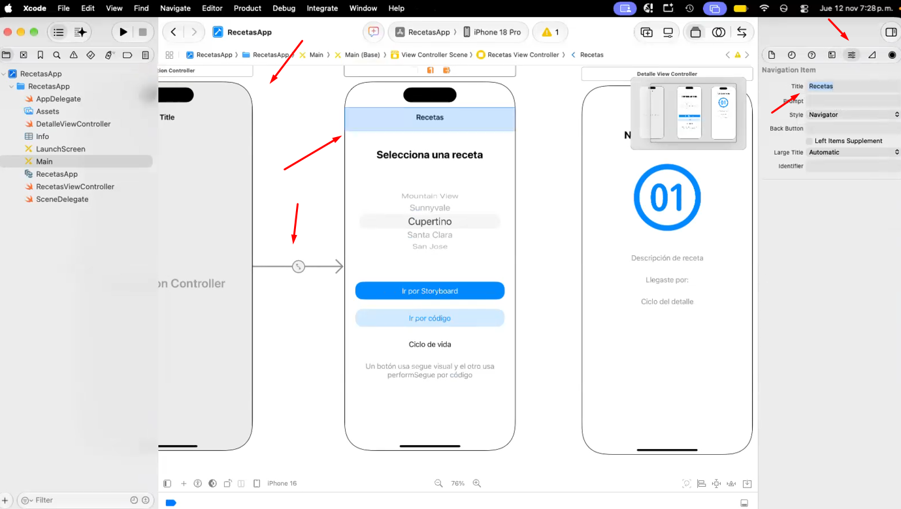
- Conectar a la siguiente vista mediante boton (anticlic, vista de conexion, Show)
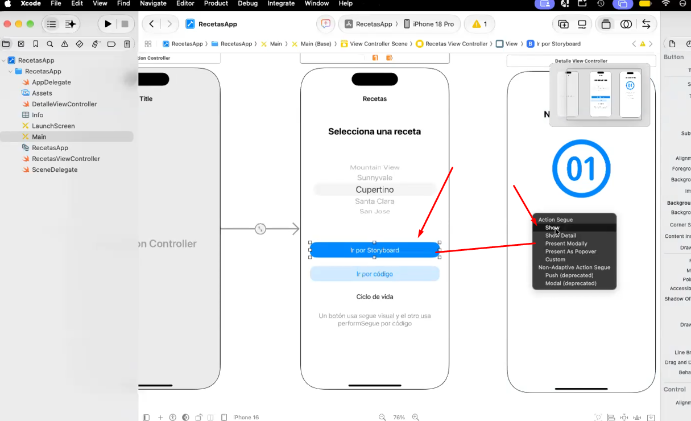
- Se puede navegar gracias al Navigation Controller
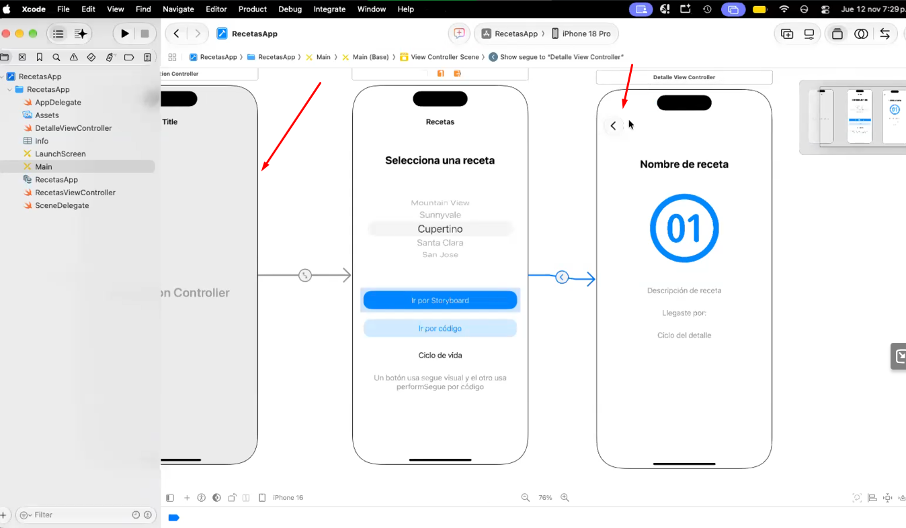
- Ponerle identificador para poder llamarlo y usarlo en el codigo
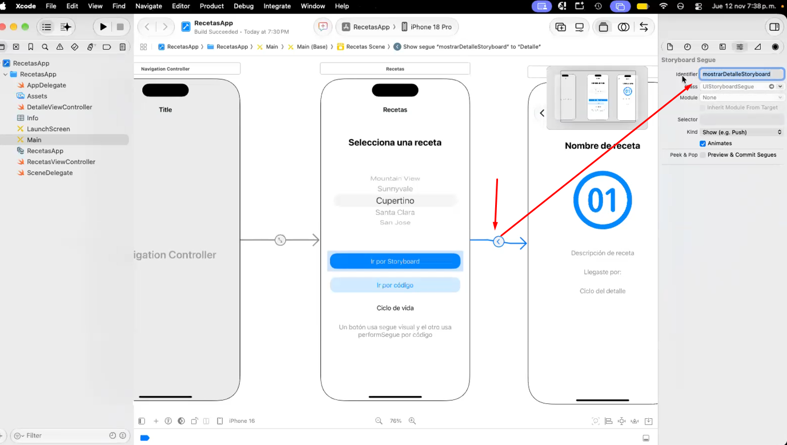
- Creó otro Show con su identificador 
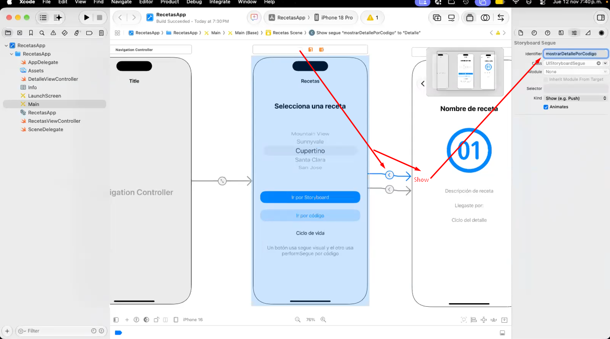

## Conectar componentes (MAIN A SUS VIEWCONTROLLERS)
- Receta
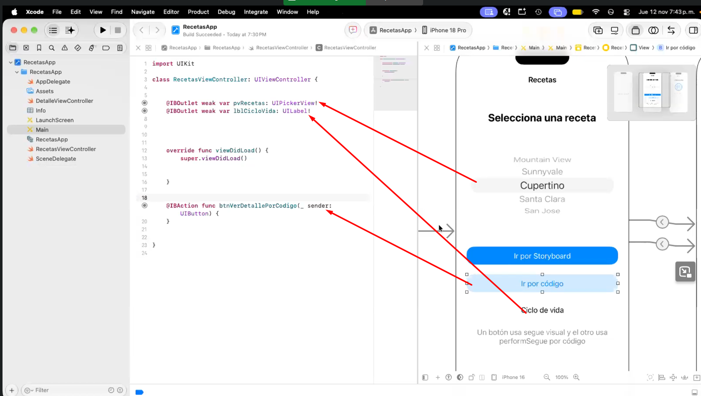
- Detalle
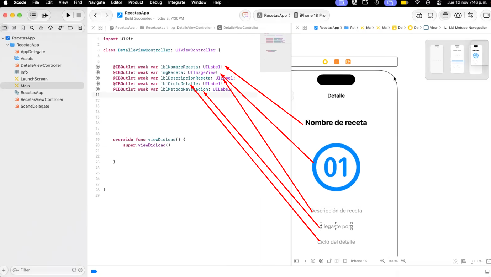
- Creacion de datos en el PickerView 
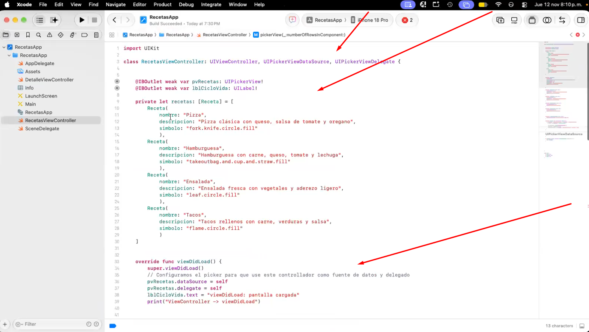
- Cantidad de columnas y cantidad dependiendo de cuanto tenga recetas
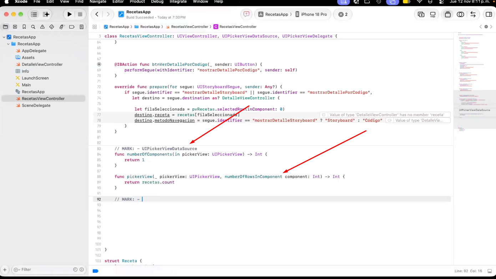
- Mostrar Titulo
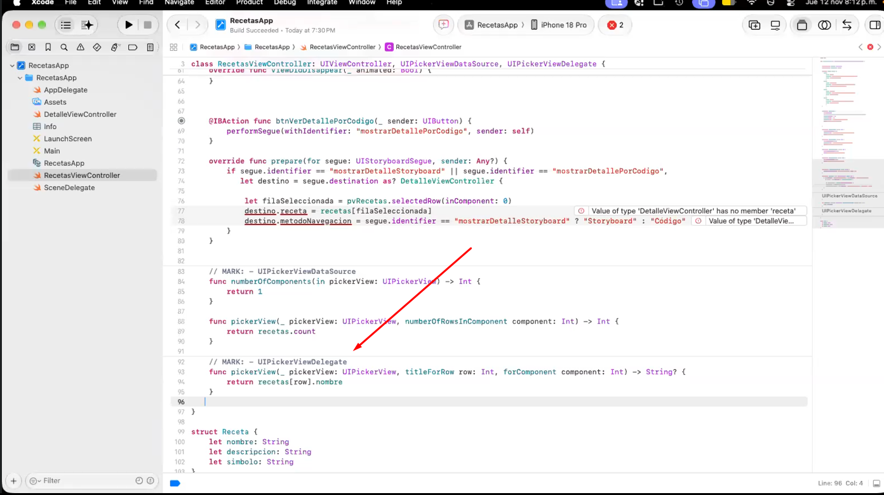

- Navegar entre ViewController (Identificador que se le puso a la linea de conexion para navegar por codigo)(Imagen 6)
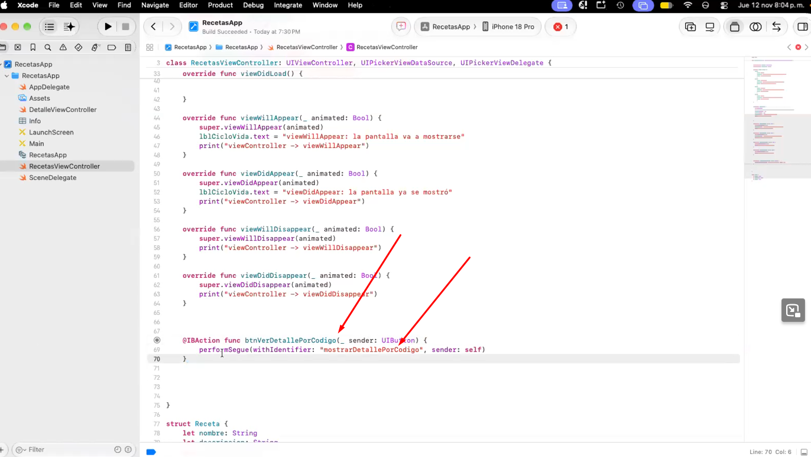

- Enviar los datos
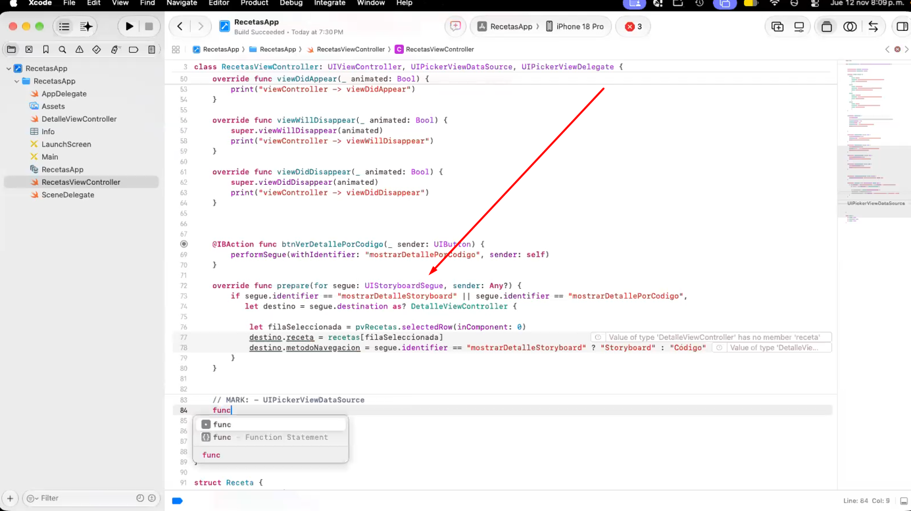

- 1.11:42